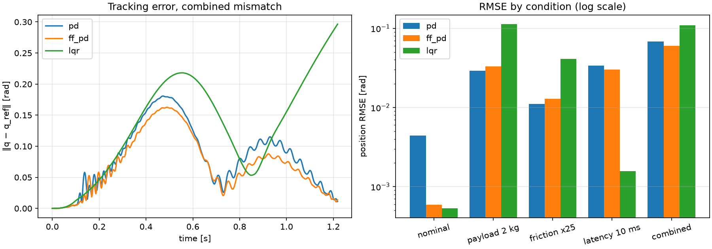
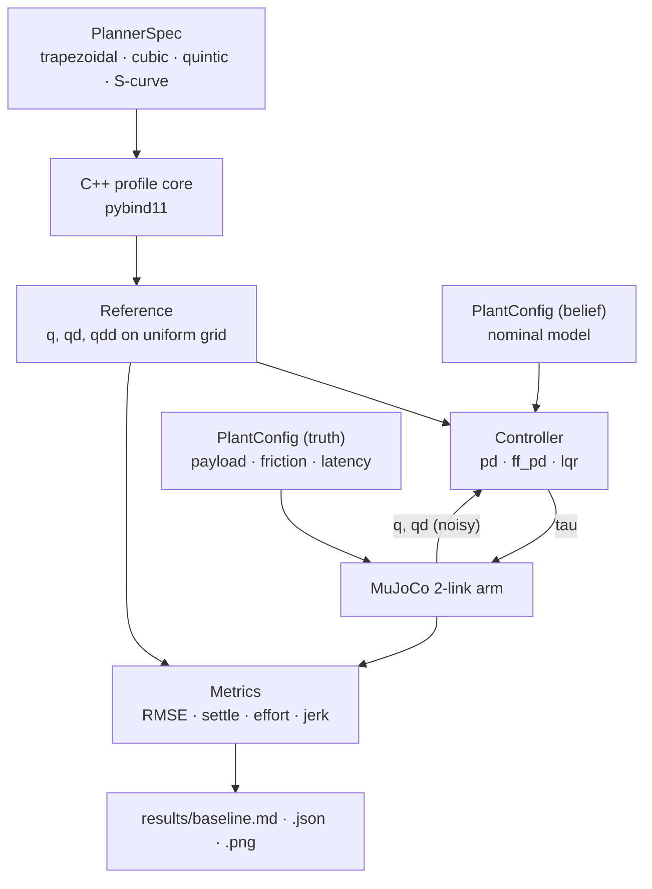

# learned-tracking

> **Classical control doesn't degrade under model error — it fails confidently.**
> This repo measures that failure, and builds the learned residual meant to fix it.



I benchmarked five analytic motion profiles against three controllers — PD,
computed-torque (inverse-dynamics feedforward + PD), and time-varying LQR — on a
planar two-link arm in MuJoCo, then injected the mismatches that break real
robots: a 2 kg unmodelled payload, 25× friction, 10 ms of control latency.

The result is not the one I expected:

- **With a correct model, feedforward is everything.** Computed torque and LQR
  are ~7× better than plain PD (6e-4 vs 4.4e-3 rad) at the same effort.
  Classical control is hard to beat when you know the plant.
- **A 2 kg unmodelled payload erases that entire advantage** — 55× worse,
  landing at the same error as PD. The feedforward torque was confidently wrong,
  and nothing in the controller noticed.
- **10 ms of latency flips the ranking**, making LQR ~19× better than computed
  torque: it is a closed-loop design, while PD and FF+PD chatter against the
  delay and saturate the actuators for most of the move.

No controller wins everywhere, and the failure isn't graceful degradation — it's
a controller applying the wrong torque with full authority and no signal that
anything is wrong. That gap is the target for a learned residual policy: don't
replace the structure, learn the model error on top of it.

---

## What's inside

| Layer | Implementation |
|---|---|
| Motion profiles | The five C++ planners from my ROS 2 package `trajectory_control`: trapezoidal, cubic, quintic, 7-phase S-curve, multi-segment. Vendored and exposed to Python via pybind11. |
| Plant | MuJoCo planar 2-link arm, joint-torque control, inertial coupling, damping, friction, actuator limits, optional latency and sensor noise. |
| Controllers | `pd` (no model), `ff_pd` (inverse-dynamics feedforward + PD), `lqr` (time-varying LQR from MuJoCo linearizations). |
| Metrics | Position/velocity RMSE, max error, settling time, control effort, torque rate, jerk, real-time factor. |

The controller never sees the true plant: `Scenario.plant` is ground truth,
`Scenario.model` is the controller's belief. Model mismatch between the two is
the whole experiment.



---

## Results

Fixed gains for all conditions (tuned once on the nominal plant), 500 Hz
control, 2 ms MuJoCo timestep. `settle 0.000` means the error never exceeded
10 mrad.

| scenario | controller | RMSE [rad] | max err [rad] | vel RMSE [rad/s] | settle [s] | \|tau\| RMS [Nm] | d\|tau\|/dt RMS [Nm/s] | jerk RMS [rad/s^3] | RT factor |
|---|---|---|---|---|---|---|---|---|---|
| nominal | pd | 0.0044 | 0.0107 | 0.0280 | 0.418 | 0.506 | 3.7 | 38.0 | 200x |
| nominal | ff_pd | 0.0006 | 0.0010 | 0.0035 | 0.000 | 0.489 | 3.8 | 37.8 | 130x |
| nominal | lqr | 0.0005 | 0.0010 | 0.0038 | 0.000 | 0.489 | 3.7 | 38.2 | 37x |
| payload 2 kg | pd | 0.0290 | 0.0596 | 0.1728 | 1.142 | 3.134 | 20.9 | 38.8 | 211x |
| payload 2 kg | ff_pd | 0.0329 | 0.0685 | 0.1916 | 1.180 | 3.042 | 19.4 | 38.7 | 127x |
| payload 2 kg | lqr | 0.1131 | 0.3861 | 0.5766 | 1.218 | 2.048 | 74.6 | 692.9 | 39x |
| friction x25 | pd | 0.0111 | 0.0228 | 0.0403 | 0.894 | 1.012 | 5.0 | 42.5 | 211x |
| friction x25 | ff_pd | 0.0128 | 0.0209 | 0.0326 | 1.060 | 1.015 | 5.0 | 41.9 | 144x |
| friction x25 | lqr | 0.0412 | 0.0674 | 0.1231 | 1.218 | 0.979 | 21.2 | 611.4 | 41x |
| latency 10 ms | pd | 0.0336 | 0.0845 | 4.0255 | 1.218 | 10.858 | 2342.8 | 102573.3 | 178x |
| latency 10 ms | ff_pd | 0.0301 | 0.0723 | 3.9635 | 1.216 | 10.527 | 2086.2 | 97396.8 | 124x |
| latency 10 ms | lqr | 0.0016 | 0.0037 | 0.0125 | 0.000 | 0.499 | 20.8 | 296.7 | 39x |
| combined | pd | 0.0685 | 0.1684 | 1.7737 | 1.218 | 9.519 | 1674.4 | 45626.3 | 179x |
| combined | ff_pd | 0.0599 | 0.1549 | 1.6380 | 1.218 | 8.461 | 1366.8 | 41296.3 | 126x |
| combined | lqr | 0.1097 | 0.2812 | 0.4818 | 1.218 | 2.257 | 72.6 | 521.2 | 39x |

### Reading the table

| controller | strength | failure mode |
|---|---|---|
| `pd` | ignores the model entirely, so mismatch costs it little | 7× worse than model-based control when the model *is* right; chatters under 10 ms delay and saturates the ±12 Nm actuators for ~75% of the move |
| `ff_pd` | best nominal accuracy (6e-4 rad) at low effort | the feedforward term is an open-loop assertion about the plant — a 2 kg payload makes it 55× worse without any warning |
| `lqr` | best under delay (1.6e-3 vs 3.0e-2 rad), because feedback is designed for the closed loop | trusts the model twice (feedforward *and* gains); worst under payload mismatch (0.11 rad) and visibly diverges at the end of the combined move |

The practical conclusion is a metric choice: **judge a controller by its worst
case across conditions, not its mean.** Every entry in the table loses
somewhere, which sets the bar for v0.2 — one policy that matches `ff_pd` on
nominal *and* `lqr` on delay, with no per-condition model.

---

## Install

```bash
git clone <this-repo> && cd learned-tracking
uv venv --python 3.12 && source .venv/bin/activate
uv pip install -e . --no-build-isolation   # builds the C++ core
```

## Run

```bash
# full grid: 5 conditions x 3 controllers -> results/
python experiments/baseline.py --plot

# one scenario
lt bench --controller lqr --scenario payload --payload 2.0 --json out.json

# tests
pytest
```

## Layout

```
cpp/                    C++ planners (from the ROS 2 trajectory_control package) + pybind11
src/learned_tracking/
    core.py             planner specs -> sampled multi-joint reference
    plant.py            MuJoCo 2-link arm, inverse dynamics, linearization
    controllers.py      pd, ff_pd, lqr
    metrics.py          tracking metrics
    experiment.py       rollout loop, markdown table
    cli.py              `lt bench`
experiments/baseline.py condition x controller grid, plots
tests/                  planners, plant, experiment smoke tests
results/                committed table, JSON and figure
```

## Roadmap

- **v0.2 — learned residual (next).** PPO policy that outputs a torque
  correction on top of `ff_pd`, trained with domain randomization over payload,
  friction and latency; evaluated on held-out conditions. Success criterion:
  match `ff_pd` on nominal *and* `lqr` on delay, without a per-condition model.
- **v0.3 — stronger baselines.** Gain-scheduled PD, online parameter
  adaptation, iLQR with online model estimation.
- **v1.0 — hardware.** Same interface on a real 2-DOF testbed or SO-101 arm,
  with the ROS 2 node from `trajectory_control` as the command source.

## License

MIT — see [LICENSE](LICENSE).
